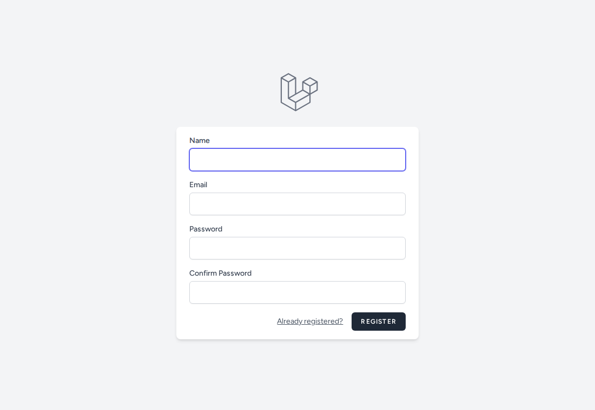
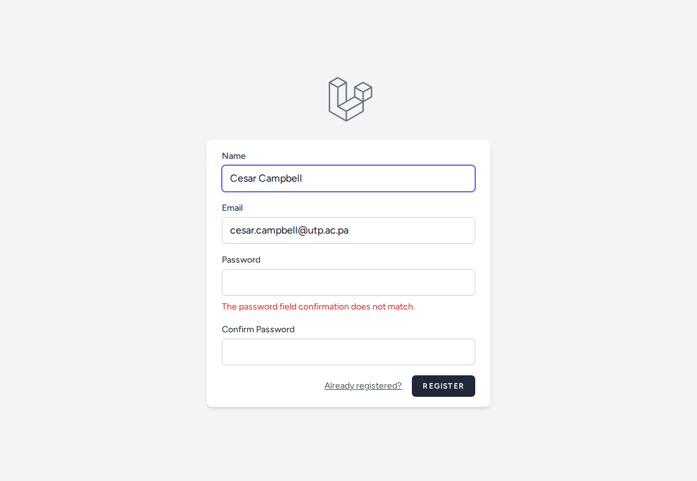
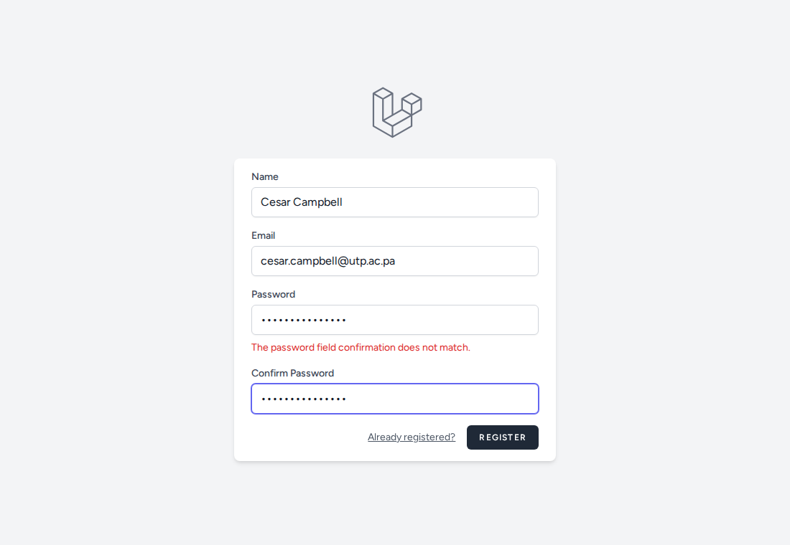
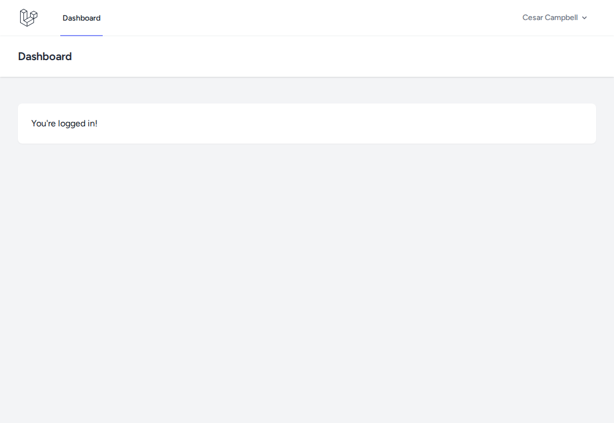
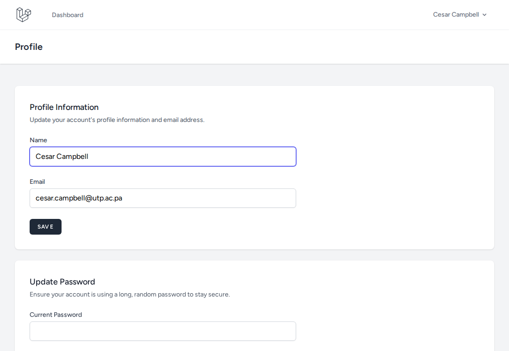
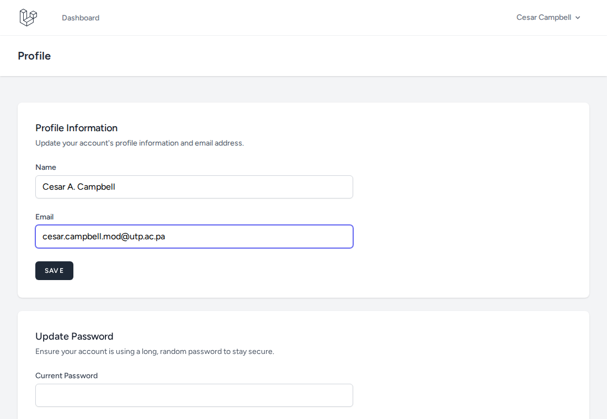
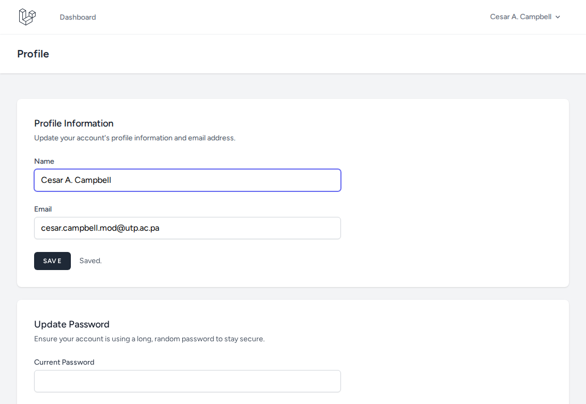
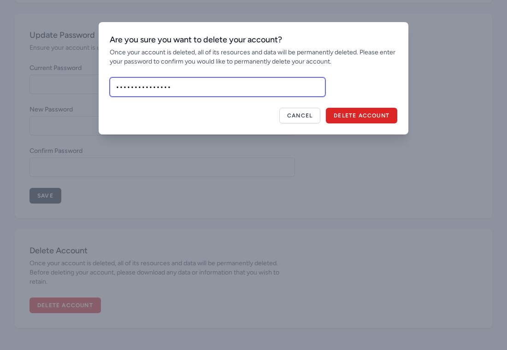
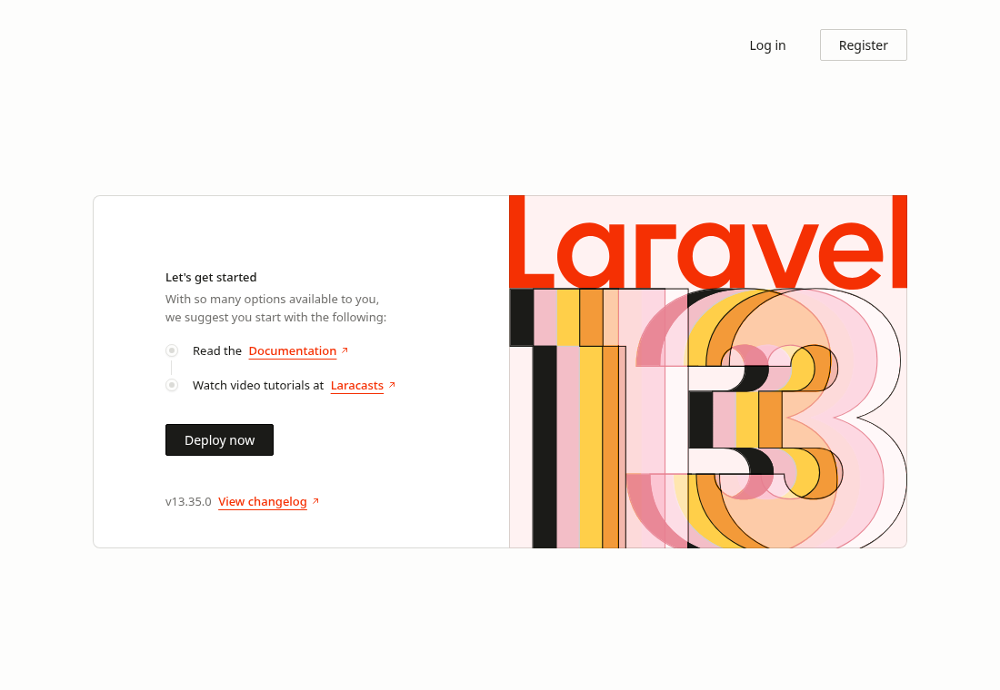
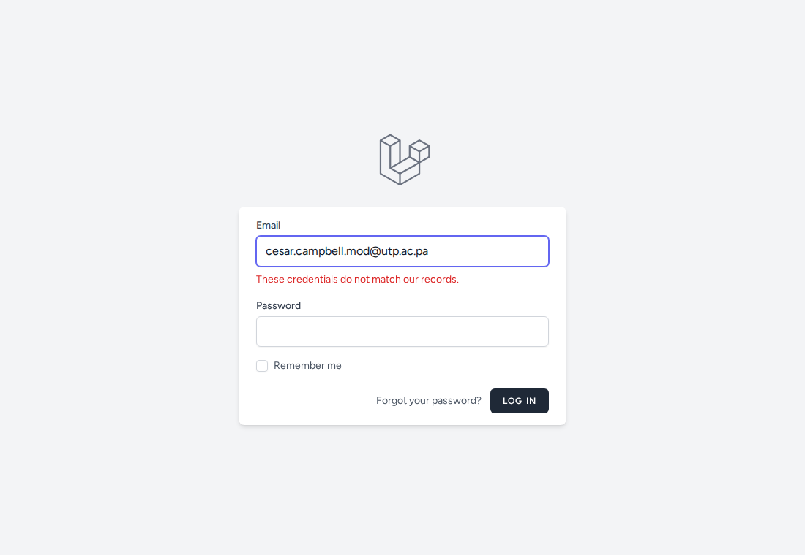

# LAB_5_LARAVEL — Sistema de usuarios con Laravel y Breeze

Aplicación web en **Laravel 13** con autenticación (registro, inicio de sesión) y gestión de la cuenta del usuario, hecha con el starter kit **Laravel Breeze** (Blade + Tailwind CSS) sobre una base de datos **SQLite**.

El laboratorio cubre las tres operaciones sobre la tabla `users`:

| Operación | Dónde se hace en la app | Ruta |
|---|---|---|
| **Insertar** | Formulario de registro | `/register` |
| **Modificar** | Perfil → Profile Information | `/profile` |
| **Eliminar** | Perfil → Delete Account | `/profile` |

---

## 1. Insertar registros

El registro de un usuario nuevo se hace desde `/register` con nombre, correo y contraseña.

**Formulario de registro vacío**



**Validación:** si la contraseña y su confirmación no coinciden, Laravel rechaza el registro y no guarda nada.



**Formulario con datos válidos**



**Registro exitoso:** el usuario se guarda en la tabla `users` (con la contraseña cifrada), inicia sesión automáticamente y llega al Dashboard.



---

## 2. Evidencia de acciones de Modificar

Con la sesión iniciada, la página `/profile` permite cambiar el nombre y el correo.

**Perfil con los datos originales**



**Datos modificados** (nombre: `Cesar A. Campbell`, correo: `cesar.campbell.mod@utp.ac.pa`)



**Cambios guardados:** aparece el mensaje *Saved.* y el nuevo nombre se refleja en la barra superior.



---

## 3. Evidencia de acciones de Eliminar

El botón **Delete Account** abre una ventana modal que pide la contraseña para confirmar.

**Confirmación de la eliminación**



**Cuenta eliminada:** el registro se borra de `users`, la sesión se cierra y la app vuelve a la página de inicio.



**Comprobación:** al intentar iniciar sesión con el usuario eliminado, Laravel responde que las credenciales no coinciden.



---

## 4. Controles utilizados

| Control / elemento | Uso en el laboratorio |
|---|---|
| Campo de texto (`type="text"`) | Nombre del usuario |
| Campo de correo (`type="email"`) | Correo del usuario (único, se usa para iniciar sesión) |
| Campo de contraseña (`type="password"`) | Contraseña, confirmación y contraseña actual |
| Casilla (`type="checkbox"`) | *Remember me* en el login |
| Botones (`submit`) | Register, Log in, Save, Delete Account |
| Ventana modal (Alpine.js) | Confirmación para eliminar la cuenta |
| Mensajes de validación | Errores bajo cada campo (`x-input-error`) y estado *Saved.* |
| Token CSRF (`@csrf`) | Protege cada formulario contra peticiones falsas |
| Método simulado (`@method('patch')`, `@method('delete')`) | Permite enviar PATCH y DELETE desde formularios HTML |
| Componentes Blade (`x-text-input`, `x-input-label`, `x-primary-button`, `x-danger-button`, `x-modal`) | Piezas reutilizables en `resources/views/components` |
| Middleware `auth` | Solo los usuarios con sesión entran a `/dashboard` y `/profile` |

---

## 5. Detalles del laboratorio

### Objetivo
Construir un sistema de registro e inicio de sesión en Laravel siguiendo el patrón MVC, y comprobar las operaciones de insertar, modificar y eliminar sobre la tabla de usuarios.

### Arquitectura MVC

| Capa | Carpeta / archivo | Contenido |
|---|---|---|
| Modelo | `app/Models/User.php` | Modelo Eloquent de la tabla `users` |
| Vista | `resources/views/` | Plantillas Blade: `auth/` (login, registro), `profile/`, `dashboard.blade.php`, `components/`, `layouts/` |
| Controlador | `app/Http/Controllers/` | `ProfileController` (editar, actualizar, eliminar) y `Auth/` (registro, login, logout, contraseñas) |
| Rutas | `routes/web.php` y `routes/auth.php` | Asocian cada URL con su controlador |

### Rutas principales

| Método | Ruta | Acción |
|---|---|---|
| GET / POST | `/register` | Mostrar formulario / **insertar** usuario |
| GET / POST | `/login` | Mostrar formulario / iniciar sesión |
| GET | `/dashboard` | Panel (requiere sesión) |
| GET | `/profile` | Ver el perfil |
| PATCH | `/profile` | **Modificar** nombre y correo |
| DELETE | `/profile` | **Eliminar** la cuenta |

### Base de datos
SQLite en `database/database.sqlite`. Las migraciones crean las tablas `users`, `password_reset_tokens`, `sessions`, `cache` y `jobs`, entre otras. Las contraseñas se guardan con hash.

### Estructura del proyecto

```
LAB_5_LARAVEL/
├── app/                  Modelos y controladores
├── assets/               Capturas de este README
├── bootstrap/
├── config/
├── database/             Migraciones, seeders y factories
├── public/               Punto de entrada (index.php)
├── resources/            Vistas Blade, CSS y JS
├── routes/               web.php y auth.php
├── storage/
├── tests/                Pruebas automáticas
├── artisan
├── composer.json
├── package.json
└── vite.config.js
```

### Verificación
Se comprobó una instalación desde cero (pasos de la sección 6) en una copia limpia de la carpeta: `/`, `/login` y `/register` responden **200** y las **25 pruebas** de `php artisan test` pasan. Las capturas se tomaron con la app corriendo sobre una base de datos de prueba.

---

## 6. Procesos de instalación

### Requisitos previos

| Requisito | Versión |
|---|---|
| PHP | 8.3 o superior (probado con 8.5.11) |
| Composer | 2.x (probado con 2.10.3) |
| Node.js y NPM | Node 22 y NPM 10 |
| Extensión PHP SQLite | `pdo_sqlite` |

En Fedora, el paquete de Node se llama `nodejs`: `sudo dnf install nodejs`.

### Pasos

1. **Clonar el repositorio y entrar a la carpeta**
   ```bash
   git clone https://github.com/Cesar-campbell/Desarrollo-Web-UTP.git
   cd Desarrollo-Web-UTP/LAB_5_LARAVEL
   ```
2. **Instalar las dependencias**
   ```bash
   composer install
   npm install
   ```
3. **Crear el archivo de entorno y la clave de la aplicación**
   ```bash
   cp .env.example .env
   php artisan key:generate
   ```
   El `.env.example` ya usa `DB_CONNECTION=sqlite`, así que no hay que configurar usuario ni contraseña de base de datos.
4. **Crear la base de datos y las tablas**
   ```bash
   touch database/database.sqlite
   php artisan migrate
   ```
5. **Compilar los estilos y scripts**
   ```bash
   npm run build
   ```
6. **Iniciar el servidor**
   ```bash
   php artisan serve
   ```
7. Abrir en el navegador: <http://127.0.0.1:8000>. Usar `/register` para crear un usuario y `/login` para entrar.

Para desarrollar con recarga automática de estilos, ejecutar `npm run dev` en una segunda terminal.

### Cómo se creó el proyecto

```bash
composer create-project laravel/laravel Lab_laravel
cd Lab_laravel
composer require laravel/breeze --dev
php artisan breeze:install blade
npm install
npm run build
php artisan migrate
```

### Dificultades y soluciones

| Problema | Solución |
|---|---|
| `dnf install node.js` no encuentra el paquete | El paquete se llama `nodejs`, sin punto |
| Vite muestra `Cannot find module 'autoprefixer'` | El servidor `npm run dev` se inició antes de terminar `npm install`. Detenerlo con `Ctrl+C`, ejecutar de nuevo `npm run dev` y recargar con `Ctrl+Shift+R` |
| La página sale sin estilos | Falta compilar los assets: ejecutar `npm run build` |

---

## 7. Tecnologías y versiones

| Tecnología | Versión |
|---|---|
| PHP | 8.5.11 (requiere ^8.3) |
| Laravel Framework | 13.35.0 |
| Laravel Breeze | ^2.4 |
| Base de datos | SQLite |
| Composer | 2.10.3 |
| Node.js / NPM | 22.23.1 / 10.9.8 |
| Vite | ^8.0 |
| Tailwind CSS | ^3.1 |
| Alpine.js | ^3.4 |
| DBeaver | Cliente usado para revisar la tabla `users` |
| Sistema operativo | Linux (Nobara / Fedora) |

---

## 8. Autor, fecha y referencias

| | |
|---|---|
| **Autor** | Cesar Campbell |
| **Aula** | 1S3122 |
| **Curso** | Desarrollo Web |
| **Docente** | Ing. Irina Fong |
| **Institución** | Universidad Tecnológica de Panamá (UTP) |
| **Fecha de ejecución** | 13 de octubre de 2026 |

### Referencias
- [Documentación de Laravel](https://laravel.com/docs)
- [Laravel Breeze](https://laravel.com/docs/starter-kits#laravel-breeze)
- [Eloquent ORM](https://laravel.com/docs/eloquent)
- [Migraciones de Laravel](https://laravel.com/docs/migrations)
- [Composer](https://getcomposer.org/doc/)
- [Vite](https://vite.dev/) y [Tailwind CSS](https://tailwindcss.com/docs)
- [Proyecto de referencia: LaravelLaboratorio2](https://github.com/AntonioCastillo507/LaravelLaboratorio2)
