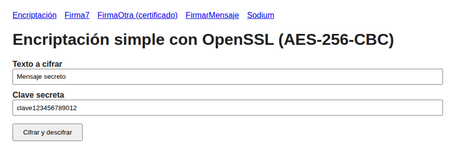
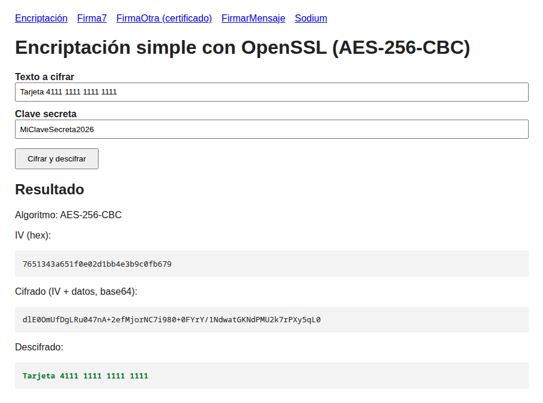
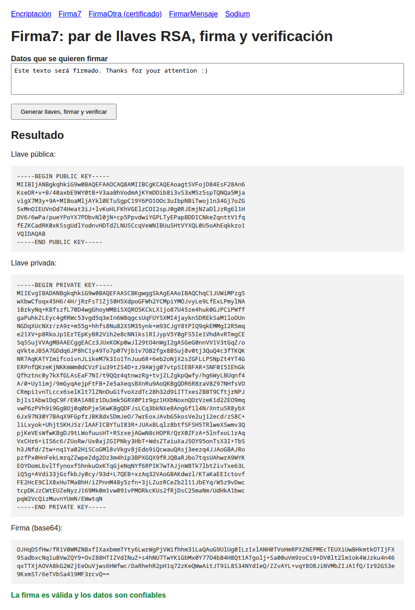
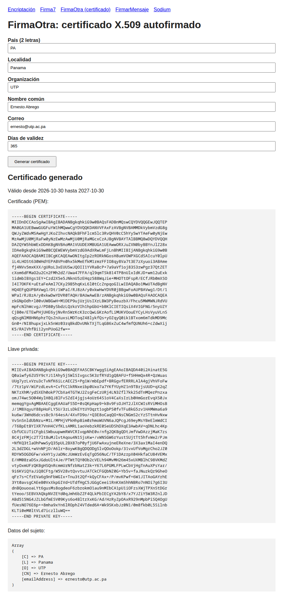
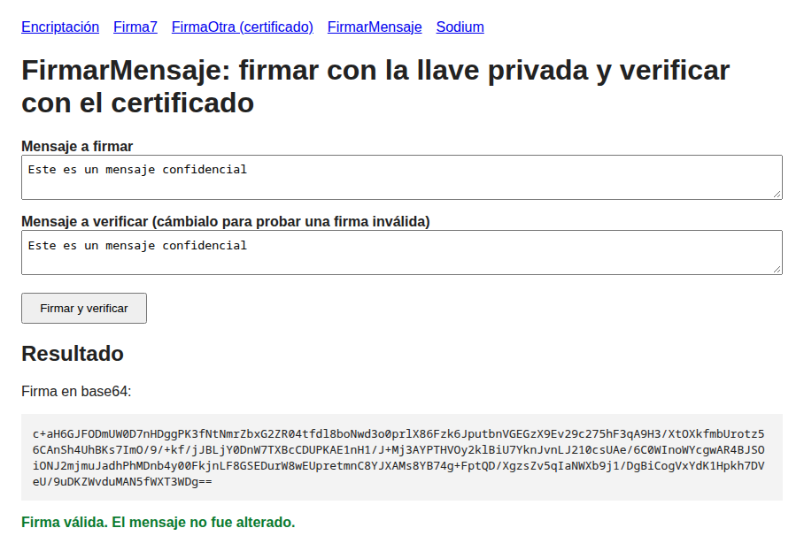
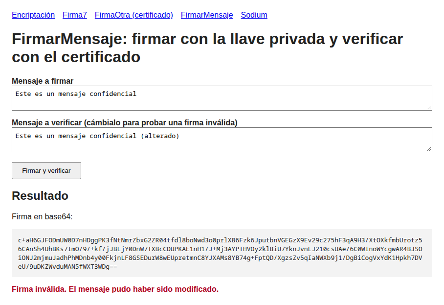
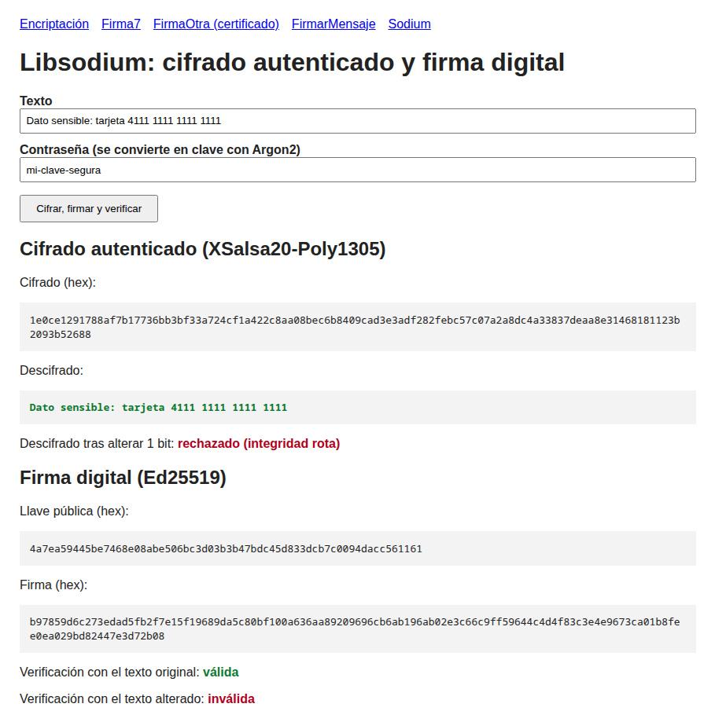

# LAB 6: Seguridad en PHP con OpenSSL y Sodium

Tema: programación segura según OWASP (protección de datos sensibles). Basado en el repositorio de la docente: https://github.com/Salomon2514/SeguridadOpenSSL

Cada script de la guía se convirtió en una página con formulario. Todas comparten `config.php` (parámetros de OpenSSL y estilos).

## Cómo ejecutarlo

1. Verificar que OpenSSL y Sodium estén activos: `php -m | grep -iE "openssl|sodium"` (en XAMPP/WAMP, `extension=openssl` sin `;` en `php.ini`).
2. Abrir `http://localhost/Desarrollo-Web-UTP/LAB_6_OPENSSL/`.
3. Orden: `firmaOtra.php` debe ejecutarse antes que `firmarMensaje.php`, porque este usa el certificado y la llave que genera el primero.

Si en Windows falla la ruta de `openssl.cnf`, `config.php` la busca solo en las rutas comunes de XAMPP. En Linux no hace falta configurar nada.

## Informe y capturas

El informe técnico en PDF está en [`Informe_Laboratorio_OpenSSL.pdf`](Informe_Laboratorio_OpenSSL.pdf).

| Página | Captura |
|---|---|
| Encriptación (formulario vacío) |  |
| Encriptación (resultado) |  |
| Firma7 |  |
| FirmaOtra (certificado) |  |
| FirmarMensaje (firma válida) |  |
| FirmarMensaje (mensaje alterado) |  |
| Sodium |  |

## Archivos

| Archivo | Qué hace |
|---|---|
| `encriptacion.php` | Cifra y descifra un texto con AES-256-CBC (`openssl_encrypt` / `openssl_decrypt`) |
| `firma7.php` | Genera un par de llaves RSA, firma un texto con SHA-256 y verifica la firma |
| `firmaOtra.php` | Genera un certificado X.509 autofirmado (CSR + firma) a partir de los datos del formulario |
| `firmarMensaje.php` | Firma un mensaje con la llave privada del certificado y lo verifica con el certificado público |
| `sodium.php` | Libsodium: derivación de clave con Argon2, cifrado autenticado, firma Ed25519 |
| `keys/`, `keysCert/` | Llaves y certificados generados (ignorados por git) |

## Funciones usadas

| Función | Propósito | Parámetros | Devuelve |
|---|---|---|---|
| `openssl_pkey_new($config)` | Crea un par de llaves | Arreglo con `private_key_bits`, `private_key_type`, `digest_alg` | Recurso de llave o `false` |
| `openssl_pkey_get_details($llave)` | Obtiene la llave pública y datos de la llave | Recurso de llave | Arreglo (`key` = pública en PEM) |
| `openssl_pkey_export($llave, &$out)` | Exporta la llave privada a PEM | Llave, variable por referencia, passphrase, config | `bool` |
| `openssl_sign($datos, &$firma, $privada, $alg)` | Firma datos: hash SHA-256 cifrado con la llave privada | Datos, variable de salida, llave privada, algoritmo | `bool` |
| `openssl_verify($datos, $firma, $publica, $alg)` | Comprueba la firma con la llave pública | Datos, firma binaria, llave pública, algoritmo | `1` válida, `0` inválida, `-1` error |
| `openssl_csr_new($dn, &$llave, $config)` | Crea la solicitud de certificado | Datos del sujeto, llave, config | Recurso CSR o `false` |
| `openssl_csr_sign($csr, null, $llave, $dias, $config)` | Firma el CSR (autofirmado si el CA es `null`) | CSR, CA, llave privada, días de validez, config | Recurso certificado o `false` |
| `openssl_x509_export($cert, &$out)` | Exporta el certificado a PEM | Certificado, variable de salida | `bool` |
| `openssl_encrypt($texto, $metodo, $clave, $flags, $iv)` | Cifra con cifrado simétrico | Texto, método (AES-256-CBC), clave, flags, IV | Texto cifrado o `false` |
| `openssl_decrypt(...)` | Descifra con los mismos parámetros | Igual que `openssl_encrypt` | Texto original o `false` |
| `sodium_crypto_pwhash(...)` | Deriva una clave desde una contraseña con Argon2 | Largo, contraseña, sal, límites de CPU y memoria | Clave binaria |
| `sodium_crypto_secretbox($msg, $nonce, $clave)` | Cifrado autenticado (confidencialidad + integridad) | Mensaje, nonce, clave | Texto cifrado con MAC |
| `sodium_crypto_secretbox_open(...)` | Descifra y verifica integridad | Cifrado, nonce, clave | Mensaje o `false` si fue alterado |
| `sodium_crypto_sign_detached($msg, $privada)` | Firma digital Ed25519 | Mensaje, llave secreta | Firma de 64 bytes |
| `sodium_crypto_sign_verify_detached($firma, $msg, $publica)` | Verifica la firma | Firma, mensaje, llave pública | `bool` |

## Mejoras respecto al código original

- Se quitó la ruta fija `C:\OpenSSL-Win64\...` (solución 1 de la guía): `config.php` detecta la ruta o deja que OpenSSL use la suya.
- El cifrado usa AES-256 con la clave derivada por SHA-256 y el IV guardado junto al cifrado.
- `firmarMensaje.php` permite alterar el mensaje antes de verificar para ver una firma inválida.
- Se agregó `sodium.php` (requerido en la sección 1.6 de la guía).
